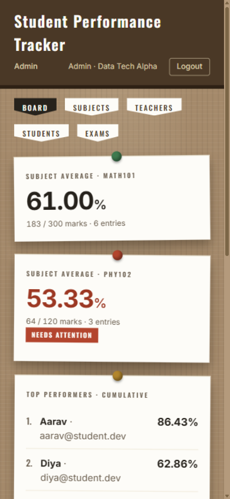
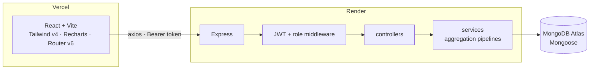

# Student Performance Tracker

Teachers record marks. Students watch their grade, rank and trend move. Admins see the whole institution — **every number computed server-side with MongoDB aggregation pipelines**, never JS loops, never sorted in the browser.


## Run the demo

```bash
# 1 — backend (needs a MongoDB Atlas MONGO_URI in server/.env, see .env.example)
cd server && npm install
npm run seed:demo        # 6 subjects · 3 teachers · 24 students · 18 exams · 320 marks
npm run dev              # API → http://localhost:5000

# 2 — frontend
cd ../client && npm install
echo "VITE_API_URL=http://localhost:5000" > .env
npm run dev              # app → http://localhost:5173
```

**Sign in with any account** — passwords are shared per role:

| Role | Any account | Password |
|---|---|---|
| Admin | `adityamahar8485@gmail.com` | `Admin@2026` |
| Teacher | `priya.nair@school.dev` · `rahul.menon@school.dev` · `sneha.kulkarni@school.dev` | `Teacher@2026` |
| Student | `firstname.lastname@student.dev` — 24 seeded, e.g. `naina.kapoor@student.dev` (topper), `aarav.sharma@student.dev` | `Student@2026` |

The seed is deterministic and includes locked exams, one **pending lock request** on the admin board, unmarked finals (empty states), and a realistic pass/fail spread — every screen has something to show.

## The three roles

| Teacher — marks entry | Student — score trend |
|---|---|
|  |  |

| Student — performance & rank | Admin — mobile |
|---|---|
|  |  |

## Architecture



```
client/src/pages/{admin,teacher,student}/   # role dashboards on one board UI
server/src/
  models/        User · Subject · Enrollment · Exam · Mark
  middleware/    protect + authorize (role gates) · security · errors
  controllers/   request handling, ownership + lock guards
  services/      ALL analytics & ranking — aggregation pipelines only
  routes/        auth · admin · teacher · student
```

**Every analytics number comes from a pipeline in `services/`** — a quarter of the assignment grade, shown here in the actual shipped code:

**Average per subject** — cumulative Σscore/ΣmaxMarks via `$group`, not a mean of ratios (`analyticsService.js`):

```js
Mark.aggregate([
  { $lookup: { from: 'exams', localField: 'exam', foreignField: '_id', as: 'examDoc' } },
  { $unwind: '$examDoc' },
  { $group: { _id: '$examDoc.subject', totalScore: { $sum: '$score' }, totalMax: { $sum: '$examDoc.maxMarks' } } },
  { $project: { avgPercentage: { $round: [{ $multiply: [{ $divide: ['$totalScore', '$totalMax'] }, 100] }, 2] } } },
  // …$lookup subject names, $sort desc
])
```

**Pass/fail per subject** — the 40% rule recomputed in-pipeline with `$cond`:

```js
passCount: { $sum: { $cond: [{ $gte: ['$score', { $multiply: ['$examDoc.maxMarks', 0.4] }] }, 1, 0] } }
```

**Student rank** — `$setWindowFields` + `$rank` over the batch cohort (`rankService.js`); the spec repeats four times that rank must never be computed in the frontend:

```js
{ $setWindowFields: { sortBy: { cumulativePercentage: -1 }, output: { rank: { $rank: {} } } } },
{ $facet: { me: [{ $match: { _id: oid } }], cohort: [{ $count: 'size' }] } }
```

**Top 3 performers** (`$group` → `$sort` → `$limit` → `$lookup` users), **lowest-average subject** (the "needs attention" pin), and **institution trend per exam** follow the same pattern.

### The exam lock — the most-missed feature, designed into the schema

```
teacher: PATCH /exams/:id/request-lock   →  lockRequested: true
admin:   PATCH /exams/:id/lock           →  isLocked: true, lockedAt
teacher: any marks write                 →  403 "locked — marks cannot be edited"
```

Two flags from day one: a request never blocks edits; only the admin's lock does. Locked exams still count in analytics — they're final.

### Data model

| Collection | Key fields |
|---|---|
| `User` | role `admin·teacher·student`, `passwordHash` (bcrypt-12), `batch` (rank cohort) |
| `Subject` | name, unique `code`, `totalMarks`, assigned `teacher` |
| `Enrollment` | `student` + `subject` — compound **unique** index (clean `$lookup`s) |
| `Exam` | `maxMarks`, `lockRequested`, `isLocked`, `lockedAt` |
| `Mark` | `exam` + `student` — compound **unique** index (bulk upserts), pre-save grade hook |

Grades are computed server-side: **A ≥90 · B 75–89 · C 60–74 · D 40–59 · F <40 · pass = 40% of exam max.**

## API reference

JSON everywhere: `{ success, data }` / `{ success, message }`; authenticated routes take `Authorization: Bearer <token>`; every `/api/admin|teacher|student` route is role-gated.

| Endpoint | Body → Response |
|---|---|
| `POST /api/auth/login` | `{ email, password }` → `{ token, user }` |
| `POST /api/admin/subjects` | `{ name, code, totalMarks }` → subject |
| `GET /api/admin/subjects` | → subjects + teacher + student count |
| `POST /api/admin/teachers` | `{ name, email, password, subject }` → teacher + assignment |
| `GET /api/admin/teachers` | → teachers + held subjects |
| `POST /api/admin/students` | `{ name, email, password, batch, subjects[] }` → student + enrollments |
| `GET /api/admin/students` | → students + enrolled subjects |
| `GET /api/admin/exams` | → exams + lock flags |
| `PATCH /api/admin/exams/:id/lock` | `{ isLocked }` → lock state (**only path that locks**) |
| `GET /api/admin/analytics` | → averages, pass/fail, top 3, lowest subject, exam trend, totals |
| `GET /api/teacher/subjects` | → own subjects + enrolled counts |
| `POST /api/teacher/exams` | `{ subject, name, date, maxMarks }` → exam (own subjects only) |
| `POST /api/teacher/exams/:id/marks` | `{ marks: [{ student, score }] }` → bulk upsert (guards: enrollment, max, lock) |
| `PATCH /api/teacher/marks/:id` | `{ score }` → corrected entry (403 when locked) |
| `GET /api/teacher/exams/:id/results` | → marks table incl. unmarked students |
| `PATCH /api/teacher/exams/:id/request-lock` | → `lockRequested` |
| `GET /api/admin/students/:id/performance` | → any student's full profile (rank, per-subject marks) |
| `GET /api/teacher/students/:id/performance` | → profile for students in the teacher's own subjects |
| `GET /api/student/subjects` | → subject cards (totals, %, grade) |
| `GET /api/student/performance` | → cumulative %, grade, **batch rank**, breakdown |
| `GET /api/student/subjects/:id/trend` | → chronological trend (Recharts data) |

## Spec ambiguities — decided and documented

| Open point | Choice |
|---|---|
| "Register and login for all three roles" vs login-only endpoint list | Admin seeds itself; admin registers teachers/students — no public registration |
| "Rank within their enrolled batch" (undefined) | Ranked within `User.batch` via the `$rank` pipeline |
| Pass/fail per subject | Counted per mark entry, threshold recomputed in-pipeline |
| "Average score per subject" | Cumulative Σ/Σ, not mean of percentages |
| Lock semantics | Only admin's `isLocked` blocks edits; requests are advisory |

## Deploy

**Backend → Render**: root `server`, `npm install` / `npm start`, env `MONGO_URI` (SRV string) · `JWT_SECRET` · `CLIENT_URL` (Vercel URL) · `NODE_ENV=production` · `ADMIN_PASSWORD` (required in prod). Health: `/api/health`; `trust proxy` is set so rate limits key per visitor; free tier sleeps ~30–60s on first hit.

**Frontend → Vercel**: root `client` (Vite auto-detected), env `VITE_API_URL` = Render URL; `vercel.json` ships the SPA rewrite for deep links.

## Tests

```bash
node tests/wipe.mjs && npm run seed && python tests/e2e.py   # 50 assertions — full graded flow, hand-computed expectations
npm run seed:demo && python tests/verify-demo.py             # 13 assertions over the demo dataset
node tests/verify-hash.mjs                                   # proof the admin password is stored bcrypt-hashed
```

The E2E suite walks the whole graded story: setup → exams → marks → corrections → lock request → admin lock → **locked-edit rejection** → exact analytics numbers → rank/trend → access control.

---

No credentials are committed — `.env` files are git-ignored; `.env.example` files carry placeholders only.
